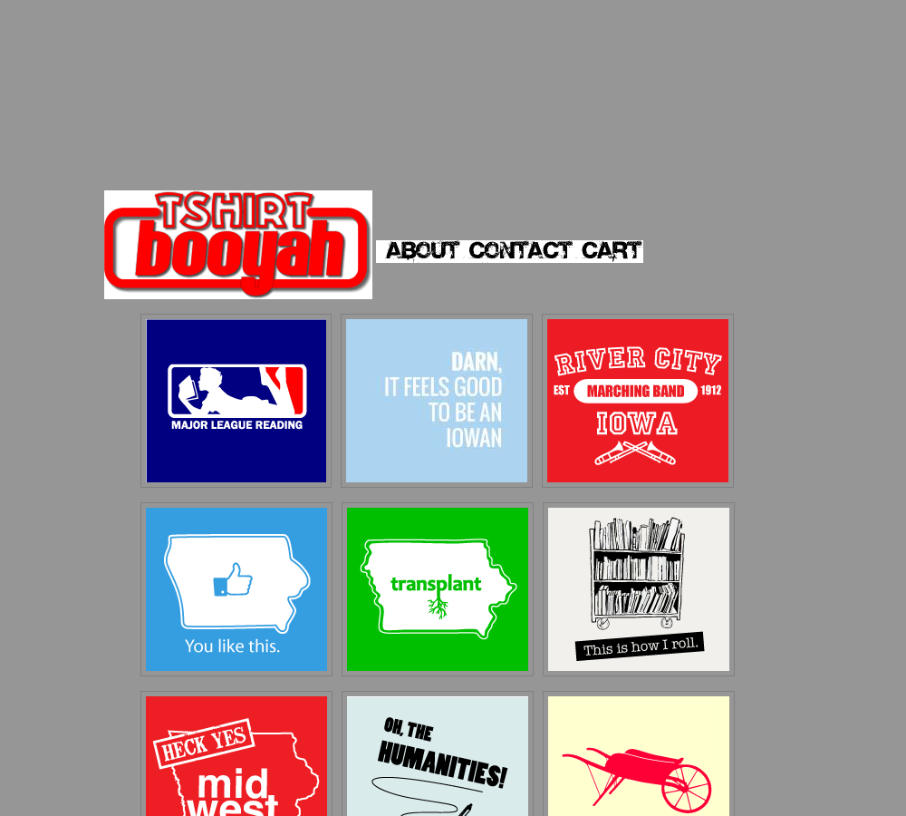
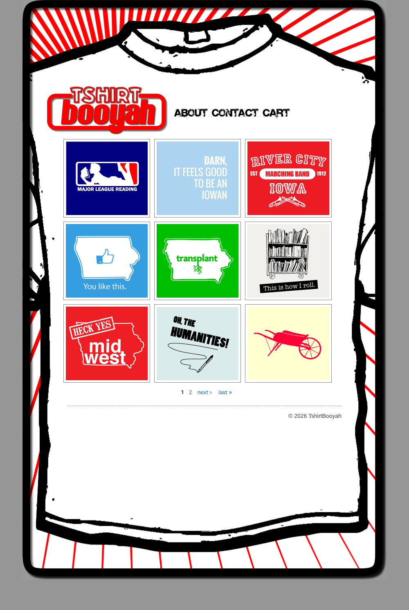
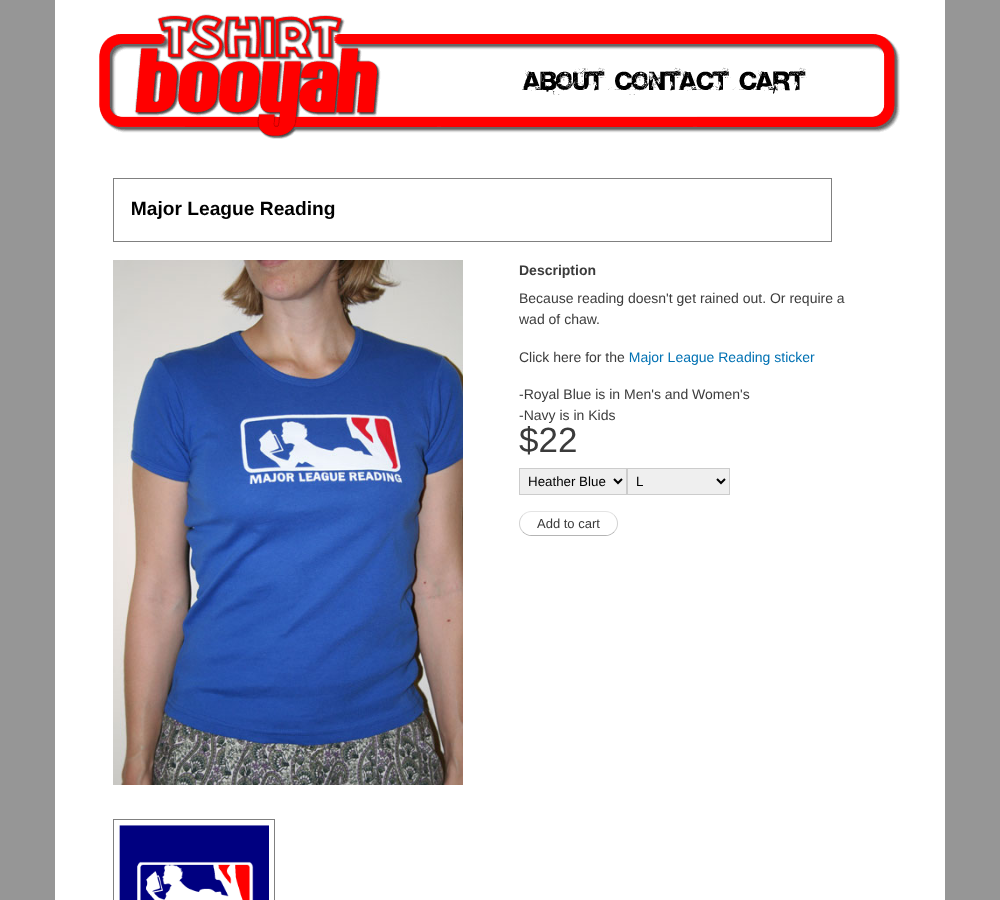
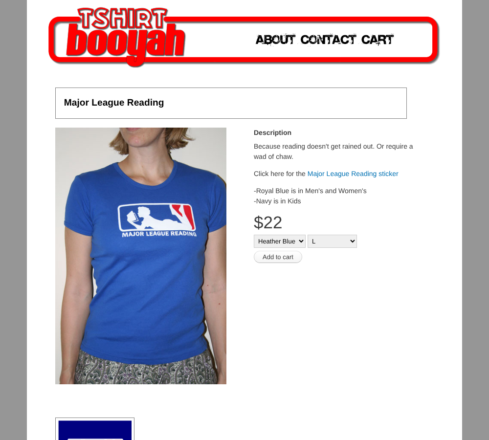

# Tshirt Booyah Shopify theme

A custom Shopify theme that recreates the look of the original tshirtbooyah.com (Drupal 6 + Ubercart). Printing and shipping are handled by a print-on-demand app such as Printful.

| Original | This theme |
| --- | --- |
|  |  |
|  |  |

The home page background (the big shirt graphic from the original site) is `assets/tshirtbooyah_logo_final.gif`. To change it, replace that file and push.

## What's in here

| Path | What it is |
| --- | --- |
| `layout/theme.liquid` | Page frame: gray background, 890px white container |
| `sections/header.liquid` | Home header (logo + nav strip) and the banner header on every other page. The old image maps are now positioned links so they still work when the image scales on phones |
| `sections/product-grid.liquid` | Home page: 3 x 3 grid of design squares with the old "1 2 next › last »" pager |
| `sections/main-product.liquid` | Product page: boxed title, photo, description, big price, option dropdowns, Add to cart, design thumbnails with zoom |
| `sections/main-cart.liquid`, `main-contact.liquid`, `main-page.liquid` | Cart, contact form and plain pages in the same style |
| `sections/main-about.liquid` | About page. Its copy lives in `templates/page.about.json` and can be edited in the theme editor |
| `assets/booyah.css` | All styling. Values copied from the old theme, plus small-screen rules at the bottom |
| `assets/booyah.js` | Variant picker and lightbox, no dependencies |
| `snippets/posthog.liquid` | PostHog analytics (pageviews, clicks, session replays, product view / add to cart / cart / checkout button events). Off until a key is set under Theme settings > Analytics |
| `tools/posthog-checkout-pixel.js` | Custom pixel for Settings > Customer events that sends the checkout steps to PostHog |
| `redirects.csv` | Old URLs mapped to the new Shopify ones, ready to import under URL redirects (Content > Menus > URL redirects in the current admin) |
| `reference/` | Screenshots and the original thumbnails, not uploaded to Shopify |

## Setting up the store

1. Install the [Shopify CLI](https://shopify.dev/docs/api/shopify-cli) and run `shopify theme dev --store your-store.myshopify.com` from this folder to preview with real data, or `shopify theme push --unpublished` to upload it.
2. Install the Printful app (or Printify), upload each design, and publish the products to Shopify. Then edit each product's URL handle to match the old URL (`major-league-reading`, `how-i-roll`, ...) so `redirects.csv` works as is. POD apps usually generate handles like `major-league-reading-t-shirt`, so check each one.
3. For each product, set options in this order: **Color**, then **Size**. That gives the same two dropdowns as the old site.
4. Optional: to show the flat artwork square on the home grid (like the old site) instead of the mockup photo, create a product metafield `custom.thumbnail` (type: file, image) and attach the square image. Without it the grid uses the product's main image.
5. Create pages with the handles `about` and `contact`. Give the contact page the `page.contact` template to get the contact form, and the about page the `page.about` template.
6. Import `redirects.csv` under Content > Menus > URL redirects (called Online Store > Navigation in older admins). Add rows for the designs on page 2 of the old site, which weren't in the saved pages.

## Checking changes

```sh
npm install
npm run check     # Shopify's theme linter
npm run preview   # renders home, product and cart with sample data into preview/
```

`npm run preview` uses liquidjs with stubbed Shopify filters, so it's a quick visual check only. Use `shopify theme dev` for the real thing.
